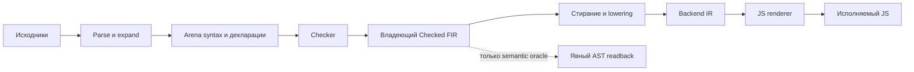

# Selfhost: Checked FIR → Backend IR

## Status 57ab (IN_PROGRESS) — supersedes the pinned 57y status below

- 57ab is the current **IN_PROGRESS** integration candidate: common CheckedFIR
  lowering extraction reviewed at `768bf3d3`; C cutover/schema/runtime/JS-foreign
  work is unintegrated and pending correctness review plus actual gates.
- The 57y/57aa fixedpoints and behavior/performance results below are pinned to
  THEIR executables. They are not inherited by the moved lowering or by any new
  C/JS renderer; a new executable needs new stage1/stage2 and behavior proof.
- Official-speed work is paused by user. Implementation/verification are delegated
  to task agents in sparse worktrees; Main only reviews/integrates.
- No full-C/native-parity claim, no “all legacy paths deleted” claim, and no test
  claim for unintegrated refs (e.g. `4d111ad5`, `2c6bc837`, `44b452fc`, pending
  CIRRenderer/CIRLayouts/JSIRForeign refs). Foreign boundary policy (BOX/callback
  conversion) and hot=0/no-seal are unverified target choices until gate evidence.

## Статус и границы

Это архитектурный контракт принятого functional FIR/BIR cutover compiler57y,
не победа над official. Историческая performance-версия55 остаётся reference.
Полный57y root8396/8793 нативно проверен; новый unchanged stage1/stage2 exact
byte fixedpoint13746315bytes/d10de8af… и frozen7720-export consumer прошли.
Все285 обязательных seed/stage1/stage2 behavior executions завершены с fresh
native AST/span parity. Original monolithic600s red, отдельная proof его не перекрашивает.
Нельзя переносить доказательства на изменённые checker, lowering или runtime ABI
без новой проверки.
В57q current native C root8400/8796 реально собранO1 под прежним8GiB guard и
выполнил полный frozen compile/7720 consumer. Короткие private C symbols и
allocation-tight native coverage comparison сохраняют точные root source/JS seed
bytesK; новый native-produced seed повторно проверен полностью. Build+run347804ms
выше цели300s; исходный monolithic gate не перекрашен. First-order continuation
57r candidates полно нативно проверены, но ОБА отвергнуты по same-host untraced
JS performance: Frame+Leaf3.25×/flat8.72× slower. Более низкий GC не компенсировал
giant dispatcher selftime. Это не production cutover и не общее отрицание defunctionalization.
57t сохраняет leaf resume closures, переносит heterogeneous Stack<A,R> внутрь
bounded native Run<R> machine и убирает Bound association/host LIFO. Для нового
Run ABI выполнены новая parser75 chain, полный native root, frozen, новый
настоящий byte fixedpoint и285behavior — не перенесены старыеK proofs.
Fresh current-root native C prototype cycle292.888s прошёл без cachedC под8GiB.
Постоянный57u public llvm-split pipeline также полностью прошёл native/frozen/
7720 consumer, но занял370.743s: TS→C producer174.087s, backend97.629s, native93.329s.
Реальные per-stage CPU/maxRSS и tool/ABI pins сохранены; причина producer variance
не установлена. Stable300s пока НЕ достигнуто. Same-host official8.619s быстрее.
57w устраняет growing-prefix copies при JS quoting. На полном native frozen
emit20.839599→6.703796s, compile93.177938→79.231488s, все7720 consumers/bytes
прежние. Свежий native build+run+consumer354.712666s пока выше300s; checker
62.408978s и TS→C producer171.733252s остаются главными задачами.
Runtimephysical вырос примерно70MB; JS fullcompile не ускорился. Source
quote change получила СВОИ свежие parser/native/fixedpoint/285 proofs, не старыеT.
Host compiler57x меняет только lazy comparison внутри mat_lits; kernel6c1df3…
и сам Bend FIR/BIR program57w не изменены. FreshX parser75/root8390/8786 прошли,
actual native-produced seed byte-identicalW7408b436…: W realFP/285 сохраняются
для того же образа, без ложного нового aggregate PASS. Untraced acceptedT
full native cycle280.457s завершён; ЧИСТЫЙ latestW cycle317.542s тоже semanticPASS,
но выше300s: producer133.080s/backend98.282s/native79.438s. Failed267s consumer-setup
run сохранён, не перекрашен. Причина source-identical producer85–133s пока неизвестна.
57y переносит String cursor через IndexLookup.find: суффикс движется вперёд,
на arbitrary backward character position сбрасывается к полному ключу; leaf
сравнивает исходный полный ключ. Presence/MSB-first33-bit codepoint encoding прежний.
Отдельный native full-current-Bend-program trial (host5b9) прошёл8414/8817+
7720consumer: check60.729247s/compile77.486618s противW62.408978/79.231488s.
Это modest separate-run observation, не statistical paired/global speed claim;
canonical host9704 заново проверил root8396/8793 и source/parser75. Новый stage
paird10de8af… реально cmp-equal;285 fresh behaviorsPASS. JS full125.240s не ускорился.
Host57aa отделяет C representation policy от physical runtime capacity:
общий inline cutoff8 words, прежний WIDE247 и прежние JS layouts. Scalar
structural context сохраняет word encoding, constructor fields нормализуются
перед bit packing. Это не новый semantic IR и не source request wrapper.
Static observed Pending payload67→3 и ArenaResult29→3; старые cumulative heap
counts не выдавать за новые live bytes или CPU gain.
Свежий parser75/full root8396/8793 прошёл, actual native-produced JS byte-identical
57y06dba46f…/12743363bytes. Реальный d10de8af… fixedpoint/285 сохраняется для
того же executable, не как новый timed aggregate PASS.
Свежий latestY native8414/8817 + frozen7720/actual consumer завершил полный
build/run/consumer за262.388s под прежними8GiB guards; runtime physical875005776bytes.
Но native compile86.573s/check60.704s/emit13.465s не доказывают runtime ускорение
против прошлого Y77.487s/60.729s/6.570s. PrivateW231.973s cycle/72.108s compile
относится к другой версии source program. Official8.619s пока быстрее;
устойчивый300s и причина вариаций не установлены.

Единственный источник этого контракта — этот файл; оперативный статус, команды,
хеши и результаты находятся в SELFHOST_HANDOFF.md и компактных version receipts.
compiler-ir-contract-v56.json содержит проверенные небольшие модели владения и
операций, а НЕ доказательство корректности полноценного FIR/BIR-компилятора.

Первая выполняемая миграция — реальный checker-to-JS путь, включая native C
исполнение самого компилятора, generated root и semantic oracle. Это не означает,
что уже существует новый C/Metal/CUDA renderer для Backend IR. Старый standalone
C-emitter не является доказательством такого renderer; его затронутые потребители
должны быть явно мигрированы и описаны, а не молча объявлены работоспособными.
Конкретный ещё живой legacy boundary: driver.dispatch_c → inspect_checked →
c_emit.bend с SyntaxTerm/DefBody. Обычный JS path этот readback не использует.
Поэтому утверждение «все старые пути удалены, любой backend идёт через BIR»
сейчас неверно; compatibility C branch не является новым BIR renderer.

## Поток данных

Не добавляем обратный переход FIR → Syntax AST → повторный вывод типов в обычную
компиляцию. Не переносим checker в JS renderer. CPS/progress — механизм исполнения
компилятора, а не ещё один семантический IR; его operational chunk64 не изменяет
существующее semantic WHNF fuel64.

## 1. Checked FIR: что уже установил frontend

Файлы: checker_ir.bend, checker_arena.bend, checker.bend,
checked_frontend.bend, scope_lookup.bend.

* Arena хранит семантические термы и компактные диапазоны. Общий semantic node ID
  остаётся идентичностью терма; он НЕ является идентичностью его проверки.
* Occurrence хранит результат конкретного вывода в конкретном контексте:
  term/type handles, проверенные дочерние occurrences, выбранный символ,
  установленное количество аргумента/параметра, факты о pattern bindings/fields.
  Один raw NodeId может проверяться в разных контекстах. Кэш NodeId → type без
  контекста не заменяет occurrences.
* Добавление фактов не должно клонировать каждый семантический узел: это разрушает
  identity-based memoization и добавляет работу. Семантический терм перестраивается
  только при фактическом изменении его elaborated children.
* Идентичность символа включает выбранного владельца, имя и вид декларации;
  intern ID написания не заменяет resolution. Для приложений и лямбд количество
  обязательно установлено, а не заново угадывается emitter по исходному типу.
* CheckedProgram — affine Type, владеющий source Arena, checked modules и финальными
  опубликованными signatures. Success передаёт владельца; Failure возвращает
  диагностический результат, а не частично готовую программу.
* До rewind публикуется ВСЯ достижимая структура: term/type handles в occurrences,
  signatures, patterns, binding facts и декларациях. Сохранить только body root
  недостаточно. Source fast path корректен лишь при source-owned reachable closure.
* Наличие конструктора CheckedProgram само по себе не доказывает валидность всех
  его U32 handles. Это внутренний контракт producer; не объявляем его автоматически
  доказанной теоремой благодаря одному имени типа.
* Runtime occurrences могут не содержать source cases, доказанно покрытые
  предыдущими patterns. Нынешняя affine usage validation намеренно проверяет
  ВСЕ исходные cases: повторный affine/erased use в пропущенной строке всё ещё
  должен отклоняться. Поэтому occurrence-only usage pass требует явных
  omitted-row usage witnesses с сохранением прежней quantity/merge семантики;
  существующий FIR сам по себе их не содержит. Контрпример реально исполнен
  в compiler-ir-checkpoint-v57h.json; original-case pass не удалён.

checked_frontend находится НАД Arena/Scope/IR: Arena уже зависит от Scope → IR.
Обратный импорт IR → Arena создаёт цикл. Явный inspection возвращает owner вместе
с AST для oracle; обычный lowering inspection не вызывает.

## 2. Граница lowering

Файлы: lower_catalog.bend и js_emit.bend. Последний сохраняет публичный EmitResult,
но перестаёт содержать второй type checker и target renderer.

1. Из опубликованных signatures, checked facts и declaration scopes строятся
   canonical symbol/layout registry и необходимые runtime type descriptors.
   Детерминированные code/constructor IDs назначаются один раз. Native primitives
   разрешаются только по существующей authoritative Base identity, не по суффиксу
   пользовательского имени.
2. Registry содержит маленькие declaration headers, НЕ тела/occurrence trees всех
   функций. Отдельный упорядоченный worklist содержит тела. Иначе индекс удерживал
   бы весь FIR после завершения отдельных функций.
3. Lowering потребляет checked occurrences, стирает QZero до построения runtime
   вычислений, превращает выражения в строгие atom-only операции, выделяет
   замыкания и фиксирует constructor layout/field identities.
4. Exact direct call допустим только для установленной callable entry и её live
   arity. Partial application сохраняет уже вычисленные captures; over-application
   сначала завершает насыщенный вызов, затем последовательно применяет результат.
5. Ветвления в контексте выражения используют явно выделенную точку продолжения
   с параметрами. Нельзя многократно копировать весь остаток блока в каждую ветку:
   это может дать экспоненциальный рост IR/кода.
6. После metadata preparation исходные duplicate module/signature roots отпускаются;
   worklist потребляется по функциям. Семантическая arena остаётся живой, пока её
   читает lowering. Готовый Backend IR не содержит arena handles и не требует owner.

Runtime descriptors — отдельный небольшой язык для существующих type/show/IO
потребителей, включая erased slots и зависимые вычисления типов. Это не повторный
вывод типов. Canonical resolution выполняется до renderer. Достижимость type
functions обходится с visited set, а не повторным разворачиванием каждой ссылки.

## 3. Backend IR: что исполняет target

Файлы: backend_ir.bend и js_backend.bend.

* Atom — local, capture, stable symbol или литерал; в нём нет скрытого вычисления.
  Чтение nullary/lazy/foreign getter — отдельная операция, иначе его можно нечаянно
  выполнить дважды или закэшировать mutable factory.
* Op — закрытая primitive operation, создание closure, direct/unary call,
  constructor/project/tag operation, descriptor value или foreign access.
* Block — упорядоченные Let, Branch и терминаторы Return/TailDirect/TailApply/Failure.
  Code владеет структурным деревом; U32 labels ссылаются на entries, а не заставляют
  компилятор рекурсивно разыменовывать произвольный граф.
* Live args, captures, parameter uses и fields явные. Erased runtime operand не
  существует. Captures идут перед обычными параметрами private code entry.
* Constructor IDs/field IDs — внутренняя идентичность; внешние tag/property names,
  включая __proto__, сохраняют действующий JS ABI.
* Renderer не получает SyntaxTerm, inference environment, source aliases или
  js_type/js_reduce. Он сериализует закрытые операции и структурные descriptors.
* Public unary callbacks, saturated export fast paths, nonmemoizing nullary
  factories и private trampoline convention остаются наблюдаемым контрактом.

Это structured ANF/block IR, а не объявление SSA ради названия. Dominance, правильная
arity, capture layout и отсутствие dangling labels — обязательные инварианты.
Полноценный CFG/SSA добавляется только если конкретный проход требует его и замер
показывает пользу; второй общий optimizer сейчас не является частью cutover.

## 4. Законы преобразований

Ниже — обязательства реализации, а НЕ уже доказанные в Bend теоремы. Обозначение
Obs включает завершение/ошибку, результат с учётом представления, порядок эффектов
и состояние ресурсов. Для foreign функций фиксируется один и тот же внешний
контракт; сравнивать недетерминированные запуски как равенство значений нельзя.

Центральный закон: для принятой программы и соответствующих входов наблюдения
исходной семантики и исполнения render(lower(CheckedFIR)) эквивалентны. Равенство
сгенерированных текстов разных архитектур НЕ требуется. Stage1/stage2 byte equality
— отдельный закон воспроизводимости, не замена семантической эквивалентности.

| ID | Закон | Что должно обнаружить нарушение |
|---|---|---|
| F1 | Publication сохраняет значение всех достижимых handles; rewind/reuse transient slots не меняет опубликованный FIR. | Реальное чтение после rewind/reuse; включая occurrence types, fields и signatures, не только root. |
| F2 | Checked occurrence сохраняет judgement в своём контексте и фактические elaborated children; resolved quantity/symbol не восстанавливаются эвристикой. | Один semantic node в разных контекстах; inferred lambdas, dependent/erased applications, aliases и shadowing. |
| F3 | Affine source owner не копируется; переходы success/failure/inspection/native handoff не оставляют use-after-free или двойное владение. | Native typed owner transport, failure и check-only drop; последующее чтение и выполнение, а не только compilation success. |
| L1 | Стирание QZero не выполняет argument computation и не сдвигает соответствие оставшихся параметров/полей. | Effectful erased argument, erased slot между live slots; typed field/parameter mapping. |
| L2 | ANF/strict Let сохраняют порядок и однократность вычисления callee/arguments/fields. | Некоммутативные операции, эффектный callee, lazy getters, последовательность trace events. |
| L3 | Direct/partial/over-application наблюдательно эквивалентны исходному curried применению. | Эффект на границе насыщения, дальнейшие аргументы, capture уже вычисленного аргумента, zero-live arity. |
| L4 | Closure conversion сохраняет bindings и разрешённое использование каждого capture; affine use не дублируется. | Shadowing, nested closures, de Bruijn rebasing, erased capture, affine value через единственную выбранную ветку. |
| L5 | Construct/project/match используют один layout; pattern bindings и field quantity относятся к фактическому instantiated constructor. | Erased fields, nested patterns, одноимённые constructors разных owners, __proto__, native scalar/string/array layouts. |
| L6 | Branch/join/tail lowering сохраняет control flow и termination без копирования continuation по числу путей. | Вложенные branch expressions, невыбранная эффектная ветка, глубокая tail/non-tail recursion; рост кода относительно входа. |
| L7 | Canonical type descriptors сохраняют type/show/IO интерпретацию, включая erased/dependent slots и native authority. | Dependent fields/type functions, match/local/rewrites в типах, shadowed Base names и Unicode names. |
| B1 | Каждая native primitive соответствует семантике своей разрешённой декларации. | U32 overflow/shifts, float bits/NaN/signed zero, Unicode/empty strings, array ownership и границы индексов. |
| B2 | Rendered entries и foreign callbacks сохраняют публичный ABI и порядок эффектов; nullary factories не memoize. | Насыщенный и частичный экспорт, extra application, mutable factory repeated reads, callback/private-tail boundary. |
| G1 | IDs, declaration order и serialization детерминированы для одного canonical input. | Два настоящих emitted stages и точное byte comparison; без переписывания результата. |
| G2 | Ускорение не ослабляет admission и полноту compiler root. | Все bodies проверены, старые negative diagnostics/span fixtures сохранены, полный corpus и все exports; нет unsafe/exclusions/patches. |
| K1 | Native CPS resumer имеет зависимый контракт `Continuation<A,R> × Value<A> → Progress<R>`; индексы не стираются посредством unsafe/host cast. | Native rejection неверных input/output equality witnesses; реальное исполнение checked resumer. |
| K2 | Defunctionalization сохраняет исходный порядок и quantities capture telescope, включая erased type parameters; affine continuation не копируется. | Зависимый live capture, erased existential type capture; native rejection повторного использования owning continuation. |
| K3 | Composition возобновляет first до next и переносит исходный boxed value без подмены. | Неперестановочный trace через разные промежуточные типы; JS/C совпадение фактического результата. |
| K4 | Операционная квота chunk остаётся структурной; opaque host только передаёт first-order frame в соответствующий native resumer. | Полный source/body admission и root ABI callers, nested Pending/Direct/Bound, новый fixedpoint/behavior/performance run; small model недостаточна. |
| K5 | `Run<R>` владеет progress некоторого A и `Stack<A,R>`; push/pop сохраняют этот индекс, `StackDone` завершает только через checked `A == R`, каждый переход расходует одну единицу operational fuel. | Native wrong-domain/owning-stack-reuse rejection, реальное прохождение Pending/Direct и более64 Bound frames; новый полный source/native/fixedpoint/frozen run. |

K1–K4 задают обязательства возможной defunctionalization57r, НЕ тип публичного
ABI текущего57t. Оба измеренных57r implementations отвергнуты; datatype
Continuation в57t не вводится. Для57t действует K5 и прежние F/L/B/G законы.

57r small model в `compiler-ir-frame-model-v57r.json` реально прошла native2.0.37,
JS и clangO1/C для indexed per-site constructors, Compose/Identity, dependent live
capture и erased existential type capture; три неверных witness/reuse programs
нативно отвергнуты. Это локальные следствия K1–K3, НЕ доказательство production
generator cutover/K4 или ускорения. Unindexed FrameOutput, возвращающий erased
captured type как live Type, был отвергнут; quantities нельзя «исправлять» promotion.
Checked equality lifting использует motive `Value<_>`/`Progress<_>`; atomic `_`
не означает автоматическую конгруэнтность семейства. Evidence сохраняет первые ошибки.

57t — другая scheduling architecture: исходные source resume closures сохранены.
`Stack<A,R>` хранит typed resume до следующего промежуточного типа B и хвост
`Stack<B,R>`; `Run<R>` хранит текущий existential progress/stack либо конечный box.
Bound только push-ится, Finished только pop-ится; association closures/Compose
не создаются. Chunk структурно убывает по Nat64 и возвращает остаточный Run.
Node и C не видят внутренний stack/request: передают owning Run в следующий
native chunk, а C скрывает flattened layout за одноразовым next/take thunk.
Это control protocol реализации компилятора, НЕ третий language IR; FIR/BIR
и их semantic/ownership contracts прежние.

Private native model364 bodies реально прошла JS/C,80 Bound frames, зависимые
Nat/Owned requests и Direct; wrong-domain/reused-stack programs отвергнуты.
Полный canonical57t root8391/8787 уже прошёл public native producer и fresh
parser75 barrier. На complete-Base paired checker CPU−20.58%, wall−16.35%;
это локальный checker-only result. Теперь новый полный native root/frozen/
fixedpoint/285 также завершён; исходный K result не переносился на новый ABI.

### Как объявлять `law` в Bend

В репозитории уже есть нужная конвенция: `law Nat.max_ge_l` сопровождается
`def Nat.max_ge_l`, а `law U32.add_comm` — конструктивным доказательством в `def`.
Один `law` задаёт спецификацию, но сам по себе не доказывает реализацию. Нельзя
добавлять неподтверждённый `law lower_preserves_semantics` и считать задачу решённой.

Для локальных чистых преобразований следует формулировать `law` и проверяемый
`def` вместе с реальным преобразованием: соответствие erased/live slots,
переименование/подстановка, closure environment и layout projections — подходящие
кандидаты. Доказательство должно говорить о production function, а не о второй
упрощённой реализации, с которой production никак не связана.

Полный семантический закон требует формализованных source/IR evaluation relations,
relation между представлениями и модели эффектов/FFI. Эти определения и доказательство
для production57 сейчас отсутствуют. Не подменяем их ни типизированностью компилятора,
ни small-model run, ни fixedpoint. Пока исполняемые контрпримеры и differential gates
проверяют конкретные следствия законов; в receipt указывается ровно это покрытие.

## 5. Проверка и критерий принятия

1. Нативно проверить фактические source modules и их ownership interfaces. Для
   mutually recursive descriptor/list helpers проверить admission, а не предполагать
   её по внешнему виду структурной рекурсии.
2. Исполнить поведенческие случаи из законов на реально rendered JS и на native
   owner boundary. Сохранить регрессии для правдоподобных consumer-visible ошибок;
   не добавлять тесты, которые проверяют лишь наличие полей или копируют wiring.
3. Пройти полный compiler root и существующие semantic/span/public/library fixtures
   на seed, stage1 и stage2. Неподходящий old AST-only fixture мигрировать к новой
   границе с сохранением проверявшегося поведения, не выкидывать coverage.
4. Получить настоящий stage1/stage2 byte fixedpoint без output patches, а затем
   выполнить полный frozen corpus и проверить фактические exports/исполнение.
5. Раздельно измерить parse, expand, check, lowering, render, host/serialization,
   whole-run time и memory peaks. Сборку компилятора не смешивать с временем его
   работы. CPU sampling не выдавать за allocation profile или полную атрибуцию.
6. Сравнивать с official2.0.37 на том же frozen input; фиксировать hardware,
   concurrency, compiler options и limits. Одного красивого прогрева недостаточно
   для общего утверждения о выигрыше. Если memory/time хуже, архитектура сама по
   себе не даёт права принять версию.

Предел пользователя — примерно пять минут для полного рабочего цикла; конечная
цель — обогнать официальный компилятор на одинаковой задаче. Пока это цель, не
обещание, что само разделение IR даст требуемую скорость. Точный последний baseline
и разложение времени находятся в compiler-native-boundary-v55.json.
